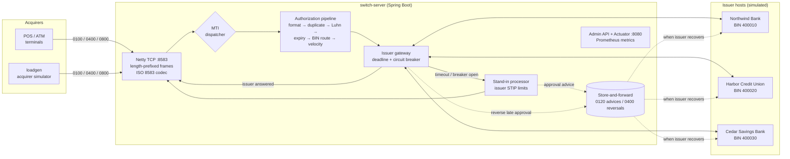
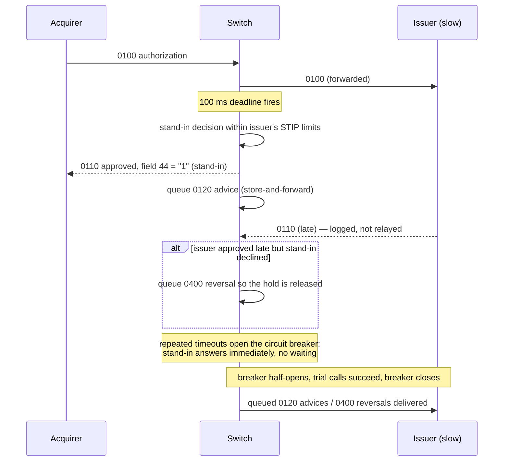
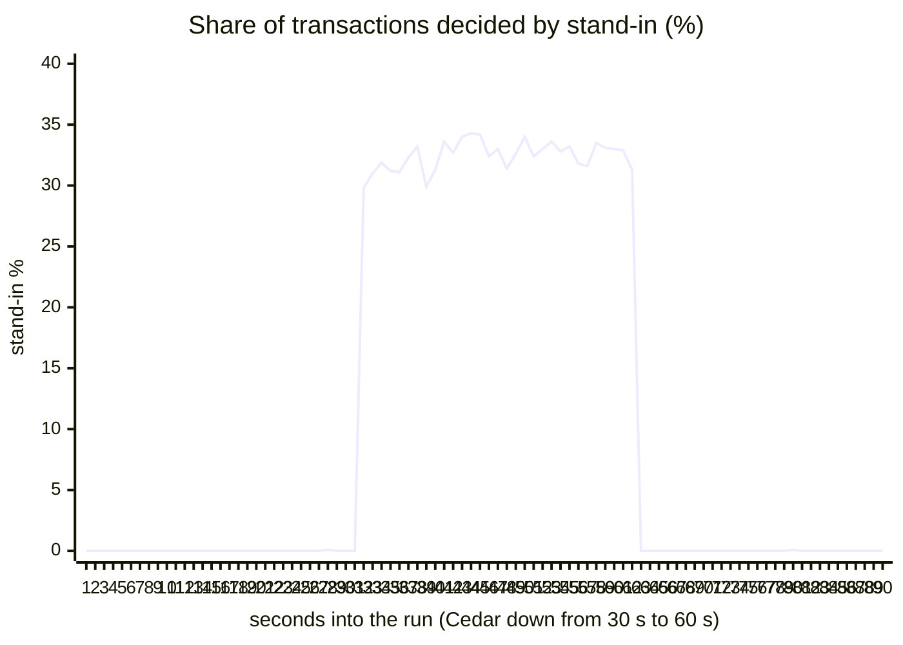
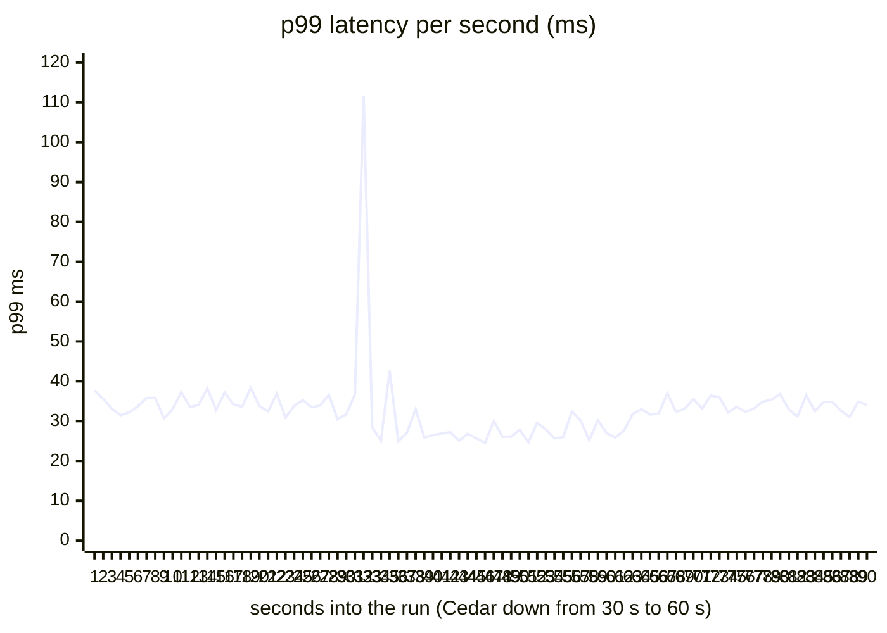

# Card Authorization Switch

A miniature card-network authorization switch, in the spirit of VisaNet. It accepts **ISO 8583** messages over
TCP, runs network-level risk checks, routes each transaction to the card's issuing bank by BIN, and returns an
approve or decline. If an issuer is slow or down, it falls back to **stand-in processing (STIP)**, so merchants
keep getting answers and the issuer still learns about every transaction later.

Java 21 · Spring Boot 4 · Netty · Resilience4j · Caffeine · Micrometer/Prometheus · HdrHistogram · JUnit

> **Results on a 4-core laptop, with the load generator on the same machine:**
> **5,000 TPS end to end at p99 34 ms** (including simulated issuer latency) with zero errors; the switch's own
> processing adds **p99 1.2 ms at 2,000 TPS** and **9.6 ms at 5,000 TPS**; and when an issuer goes down at
> 2,000 TPS, stand-in processing takes over within 2 s with **zero failed transactions out of 180,000**.
> [Details and methodology below.](#performance)

## What it does

- **ISO 8583 codec written from scratch**: MTI, primary and secondary bitmaps, fixed / LLVAR / LLLVAR fields,
  strict validation. Card data (PAN, expiry, track 2) is masked in every log line and error message.
- **Netty TCP server** with the 2-byte length-prefixed framing used on card network links. Many requests are in
  flight per connection; responses go back as soon as they're ready and the acquirer matches them by STAN.
- **Authorization pipeline**: format validation, duplicate-transmission detection, Luhn check, expiry, BIN routing
  (longest-prefix match), and per-card velocity limits. Each check returns the standard ISO 8583 response code.
- **Non-blocking issuer calls** with a per-issuer deadline and **circuit breaker**. A slow issuer never ties up a
  thread, and a dead one is skipped immediately instead of being waited on.
- **Stand-in processing** within limits the issuer configures (per transaction and cumulative per card). Every
  stand-in approval is queued as an **0120 advice** and delivered by **store-and-forward** when the issuer recovers.
- **Late-response reconciliation**: if the issuer approves *after* the switch already declined in stand-in, the
  switch automatically sends a **0400 reversal** so the cardholder's funds aren't left on hold.
- **Reversals (0400)**, **network management (0800 sign-on / echo)**, and three **mock issuer banks** with real
  account balances, holds, blocked and stolen cards, and adjustable latency for fault injection.
- **Open-model load generator** that speaks ISO 8583 over TCP and records latency with HdrHistogram from each
  request's *scheduled* send time, which avoids the coordinated-omission error.
- 56 tests, including end-to-end TCP tests of the timeout → stand-in → circuit breaker → store-and-forward path.

## Architecture



| Module | What's in it |
|---|---|
| [`iso8583`](iso8583/src/main/java/com/cardswitch/iso8583) | Dependency-free codec (`IsoCodec`, `IsoMessage`, `IsoSpec`), response codes, Luhn and PAN utilities |
| [`switch-server`](switch-server/src/main/java/com/cardswitch/server) | The switch: Netty server, pipeline, routing, gateway, stand-in, store-and-forward, simulated issuers, admin API |
| [`loadgen`](loadgen/src/main/java/com/cardswitch/loadgen) | Acquirer simulator CLI: `run` (load test), `send` (one transaction), `cards` (test card numbers) |

### Authorization pipeline

Cheapest checks run first. The first failure decides the response, and field 44 records who decided.

| Step | Check | Decline code |
|---|---|---|
| 1 | Mandatory fields, supported processing code (purchase / cash), amount > 0 | `30` format error, `12` invalid transaction, `13` invalid amount |
| 2 | Duplicate transmission (same acquirer, terminal, STAN and time within 2 min) | `94` |
| 3 | Luhn check digit | `14` invalid card number |
| 4 | Expiry date (valid through the end of the month) | `54` expired card |
| 5 | BIN routing, longest prefix wins | `15` no such issuer |
| 6 | Velocity: at most 5 attempts / $3,000 per card per 60 s (catches card testing) | `65` / `61` |
| 7 | Issuer decision (balance, card status) | `51` insufficient funds, `05` do not honor, `43` stolen card… |
| 7b | Issuer silent past 100 ms, or breaker open → stand-in | `00` within STIP limits, otherwise `91` |

Field 44 response source: `0` switch, `5` issuer, `1` stand-in after issuer timeout, `4` stand-in because the
issuer is unavailable.

Steps 1–6 are in-memory checks that run inline on the Netty event-loop thread. Step 7 is asynchronous: the
issuer call returns a `CompletableFuture`, and a scheduled task enforces the deadline. Whichever finishes first
wins an atomic flag, so no thread ever blocks waiting on a bank.

### When the issuer is slow or down



Things that make this behave like a real network rather than a toy:

- **The issuer's limits bound stand-in risk.** Each issuer sets a per-transaction ceiling and a cumulative
  per-card ceiling (e.g. Northwind: $250 and $500 per 24h). Above that, the switch declines with `91`.
- **Exactly-once effect on the cardholder.** The mock issuer applies a message when it arrives, so a "late"
  approval really did place a hold. Advices are de-duplicated by RRN, and late approvals that stand-in declined are
  reversed. The integration tests check the final balance in every combination.
- **A dead issuer stops being retried.** Store-and-forward delivery goes through the same circuit breaker, so a
  dead issuer isn't hammered and the queue drains automatically once it recovers.

### Message format

ASCII data elements, binary bitmaps, 2-byte big-endian length header. Real output of `loadgen send` against a
running switch. The dump masks PAN and expiry itself. The first message from a freshly started client JVM
includes that JVM's own warm-up time.

```text
>>> Request
MTI 0100
  [  2] Primary account number               '400010******0018'
  [  3] Processing code                      '000000'
  [  4] Amount, transaction                  '000000004250'
  [  7] Transmission date & time             '1006152842'
  [ 11] System trace audit number            '000001'
  [ 12] Time, local transaction              '152842'
  [ 13] Date, local transaction              '1006'
  [ 14] Date, expiration                     '****'
  [ 18] Merchant type                        '5541'
  [ 22] POS entry mode                       '051'
  [ 25] POS condition code                   '00'
  [ 32] Acquiring institution ID code        '100001'
  [ 37] Retrieval reference number           '005220000001'
  [ 41] Card acceptor terminal ID            'LOAD0001'
  [ 42] Card acceptor ID code                '000000000100003'
  [ 43] Card acceptor name/location          'NORTHGATE FUEL         SEATTLE      WAUS'
  [ 49] Currency code, transaction           '840'
<<< Response (136.58 ms)
MTI 0110
  [  2] Primary account number               '400010******0018'
  [  3] Processing code                      '000000'
  [  4] Amount, transaction                  '000000004250'
  [  7] Transmission date & time             '1006152842'
  [ 11] System trace audit number            '000001'
  [ 12] Time, local transaction              '152842'
  [ 13] Date, local transaction              '1006'
  [ 32] Acquiring institution ID code        '100001'
  [ 37] Retrieval reference number           '005220000001'
  [ 38] Authorization ID response            '003265'
  [ 39] Response code                        '00'
  [ 41] Card acceptor terminal ID            'LOAD0001'
  [ 42] Card acceptor ID code                '000000000100003'
  [ 44] Additional response data             '5'
  [ 49] Currency code, transaction           '840'
=== 00 Approved (decided by: Issuer)
```

## Performance

Measured with the bundled open-model load generator. Latency is taken from each request's **scheduled** send
time (HdrHistogram), so stalls can't hide (no coordinated omission). Everything runs on one laptop: Intel
i5-1135G7 (4 cores / 8 threads), 8 GB RAM, Windows 11, JDK 21, G1 with a 10 ms pause goal. The load generator
shares the CPU with the switch, and the laptop was on battery, so these are conservative numbers. Reproduce them
with `scripts/benchmark.sh`; the investigation behind the tuning is in [docs/performance.md](docs/performance.md).

**Switch alone**: the issuers answer instantly, so this is the switch's own cost per transaction: decoding,
checks, routing, encoding and TCP.

| Target TPS | Achieved TPS | p50 | p90 | p99 | p99.9 | max | Errors |
|---:|---:|---:|---:|---:|---:|---:|---:|
| 2,000 | 2,000 | 0.29 ms | 0.40 ms | **1.23 ms** | 12.2 ms | 18.4 ms | 0 |
| 5,000 | 5,000 | 0.26 ms | 0.36 ms | **9.61 ms** | 18.7 ms | 25.0 ms | 0 |
| 10,000 | 10,000 | 0.26 ms | 2.47 ms | 57.6 ms | 121 ms | 125 ms | 0 |
| 15,000 | 15,000 | 24.4 ms | 318 ms | 467 ms | 473 ms | 480 ms | 0 |

Throughput keeps up through 15,000 TPS, but past ~10,000 TPS the laptop's CPU (shared with the load generator)
saturates and queueing shows up in the tail.

**End to end**: issuers with simulated latency (medians 2 / 4 / 6 ms, p99 12 / 20 / 30 ms) and 1% of approvals
reversed.

| Target TPS | Achieved TPS | p50 | p90 | p99 | p99.9 | Approved | Errors |
|---:|---:|---:|---:|---:|---:|---:|---:|
| 1,000 | 1,000 | 12.7 ms | 20.8 ms | 33.3 ms | 49.8 ms | 96.6% | 0 |
| 2,000 | 2,000 | 12.5 ms | 20.6 ms | 33.3 ms | 49.2 ms | 96.4% | 0 |
| 5,000 | 5,000 | 12.1 ms | 20.5 ms | **34.3 ms** | 51.4 ms | 96.2% | 0 |

Latency stays flat as load grows 5x, so the issuers' (simulated) response time dominates. The p50 is higher
than the simulated medians because, on battery power, Windows rounds the simulator's short sleeps up to its
15.6 ms timer tick (see [docs/performance.md](docs/performance.md#1-windows-timer-granularity-simulated-latency-was-3x-too-high)).
The ~3.5% declines are deliberate: the generator sends invalid cards, expired cards and unknown BINs, and the
mock issuers hold blocked, stolen and low-balance cards.

**Issuer outage**: 2,000 TPS for 90 s; Cedar Savings Bank (about 1/3 of traffic) stops answering at 30 s and
comes back at 60 s.

| | Result |
|---|---|
| Transactions | 180,000 sent, **180,000 answered, 0 timeouts, 0 errors** |
| Failover | Within ~2 s, Cedar's share moved to stand-in (30–34% of all traffic each second); breaker open, no waiting |
| Worst second | p99 112 ms: the requests that waited out the 100 ms deadline while the breaker was still learning |
| During the outage | p99 25–43 ms per second, vs 31–38 ms before the outage, because Cedar's traffic is answered instantly |
| Approval rate | 94–97% every second; 0.6% declined `91` for exceeding Cedar's stand-in limits |
| Recovery | Breaker closed and stand-in dropped to 0% within 3 s of Cedar returning; all advices delivered (SAF depth 0) |






## Running it

**Prerequisites:** JDK 21+. Nothing else; the Maven wrapper downloads Maven.

```bash
# Windows PowerShell: point this terminal at JDK 21 if it isn't your default
#   $env:JAVA_HOME = "$env:USERPROFILE\.jdks\jdk-21.0.12.1+1"; $env:Path = "$env:JAVA_HOME\bin;$env:Path"
# (or dot-source the helper:  . .\scripts\env.ps1)

./mvnw package                     # build + run all 56 tests (use mvnw.cmd in cmd.exe)
java -jar switch-server/target/switch-server-1.0.0-SNAPSHOT.jar
```

The switch listens for ISO 8583 on `127.0.0.1:8583` and serves the admin API and metrics on `127.0.0.1:8080`.
In a second terminal:

```bash
LOADGEN="java -jar loadgen/target/loadgen-1.0.0-SNAPSHOT.jar"

$LOADGEN send --amount 42.50 --reverse          # approve, then reverse; prints both messages field by field
$LOADGEN send --bin 400020 --index 13           # a card the issuer reports stolen -> 43
$LOADGEN send --pan 4000100000000007            # bad check digit -> 14, declined by the switch
$LOADGEN cards --bin 400030 --count 20          # list test cards (index ending 07 = blocked, %250==13 = stolen)

$LOADGEN run --tps 1000,2000,5000 --duration 30 # load test, one stage per rate

# Fault injection: take Cedar down 20 s in, bring it back at 40 s, and watch the stand-in % column
$LOADGEN run --tps 2000 --duration 60 --chaos 20:cedar:available=false,40:cedar:available=true
```

Operations endpoints:

```bash
curl localhost:8080/admin/issuers                 # breaker state, failure rate, SAF backlog, simulator settings
curl localhost:8080/admin/stats                   # authorizations by response code and by decision source
curl -X PUT localhost:8080/admin/issuers/harbor/simulator \
     -H 'Content-Type: application/json' -d '{"medianLatencyMs":300,"p99LatencyMs":900}'
curl localhost:8080/actuator/prometheus | grep switch_
```

Configuration (timeouts, velocity limits, breaker thresholds, issuers, BINs, STIP limits, simulated latency) is in
[`application.yml`](switch-server/src/main/resources/application.yml). `scripts/benchmark.sh` reproduces every
number in this README.

## Design decisions and trade-offs

- **Hand-written codec instead of jPOS.** The point was to understand the format: bitmaps, variable-length
  prefixes, padding rules. It's a few hundred lines with no dependencies, and strict: anything unexpected is
  rejected, not guessed at.
- **Netty, not Spring MVC, for the card protocol.** Card links are long-lived TCP connections that carry many
  interleaved requests. Spring Boot still provides configuration, lifecycle, metrics and the admin API.
- **Issuers sit behind a message-based `IssuerClient` interface.** The simulators run in-process, but the gateway
  only sees ISO 8583 in and out, so a TCP connection to a real issuer host is a drop-in replacement.
- **ASCII encoding.** Real networks use BCD/EBCDIC variants (Visa BASE I, Mastercard CIS); field encoding is
  isolated in `IsoCodec`/`IsoSpec`, so another dialect is a new spec, not a rewrite.
- **What a production switch would add:** a durable store-and-forward log (e.g. Kafka or a database) instead of
  in-memory queues, PIN translation and MAC verification in an HSM, currency conversion, clearing and settlement,
  multiple active nodes, and TLS on links.

## Ideas for further work

- Allocation-free duplicate detection and velocity tables (fewer long-lived objects means shorter GC pauses; see
  the performance notes).
- Run the issuer simulators as separate processes over TCP to exercise connection management and multiplexing on
  the issuer side too.
- Docker Compose with Prometheus + Grafana dashboards for TPS, latency and stand-in rate.
- Balance inquiry (processing code `31`) and partial reversals (field 95).
